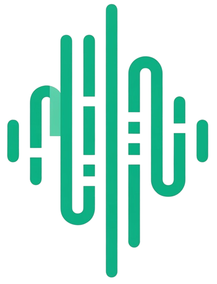

<div align="center">
  <a href="https://netra-uptime.com" target="_blank">
    
  </a>
  <h1 style="border:none; margin-top: 10px; margin-bottom: 6px;">Netra Uptime Documentation</h1>
  <p><strong>Official Documentation Portal, Interactive API Reference & Architecture Guides for Netra Uptime</strong></p>

  <p>
    <a href="https://kit.svelte.dev/"></a>
    <a href="https://tailwindcss.com/"></a>
    <a href="https://vite.dev/"></a>
  </p>

  <p>
    <a href="https://netra-uptime.com"><strong>Live Website</strong></a> •
    <a href="https://github.com/Xuerns/Netra-Uptime"><strong>Core Repository</strong></a> •
    <a href="#overview"><strong>Overview</strong></a> •
    <a href="#quick-start"><strong>Quick Start</strong></a> •
    <a href="CONTRIBUTING.md"><strong>Contributing</strong></a> •
    <a href="https://github.com/Xuerns/NetraUptime.dev/issues"><strong>Report Issue</strong></a>
  </p>
</div>

## Overview

**NetraUptime.dev** is the official documentation platform, landing website, and technical knowledge base for **[Netra Uptime](https://github.com/Xuerns/Netra-Uptime)** — the modern, lightweight, and self-hosted uptime and status monitoring platform.

This repository powers the complete documentation portal, including:

- **Comprehensive Guides**: Step-by-step setup, configuration, monitoring protocols, and notification channel integrations.
- **Interactive API Reference**: Comprehensive specifications for public and internal REST APIs with interactive parameters and code examples.
- **In-Depth Architecture Documentation**: Technical breakdown of backend worker pools, alert evaluation engines, and real-time state management with interactive Mermaid diagrams.
- **Official Landing Page**: Product overview, interactive feature showcases, integrations directory, and FAQ accordion.

Built with **SvelteKit 5**, **Tailwind CSS 4**, and **Vite**, this site is designed for fast navigation, static prerendering, and developer-friendly contribution.

## Quick Start

Run the documentation site locally on your machine for previewing or contributing changes.

### 1. Clone the Repository

```bash
git clone https://github.com/Xuerns/NetraUptime.dev.git
cd NetraUptime.dev
```

### 2. Install Dependencies

```bash
pnpm install
```

### 3. Start Development Server

```bash
pnpm dev
```

The documentation portal will be available at: **[http://localhost:5173](http://localhost:5173)**.

## Validation & Code Quality

Before opening a pull request, ensure all linters, formatters, and type checks pass:

```bash
# Type check with svelte-check
pnpm run check

# Check formatting and linting
pnpm lint

# Format code with Prettier
pnpm run format

# Build production static bundle
pnpm run build

# Preview production build locally
pnpm run preview
```

## Contributing

We welcome contributions to improve the documentation, add new guides, update API specifications, and expand architecture diagrams!

Please read our **[Contributing Guide](CONTRIBUTING.md)** for detailed instructions on the fork workflow and required Pull Request format.

## Related Repositories

- **[Netra-Uptime](https://github.com/Xuerns/Netra-Uptime)**: Core application repository (Go backend + SvelteKit dashboard).
